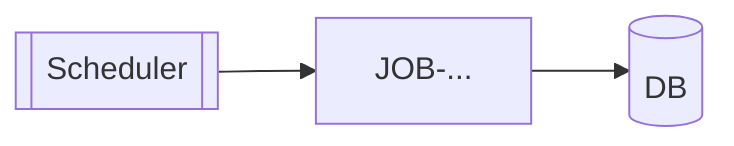

# APP-MODEL: <app name>

| Field | Value |
| --- | --- |
| Source path | |
| Commit | `<git rev-parse HEAD>` (dirty: yes/no) |
| Build | Maven / Gradle, modules: |
| Java | |
| Spring Boot / Spring Batch | |
| Kinds | spring-batch / spring-boot-web / jakarta-batch / plain-java / ... |
| Analyzed on | YYYY-MM-DD |

## Scope

- Analyzed in depth:
- Inventoried only:
- Not analyzed (and why):

## Entry points and jobs

| ID | Kind | Trigger | Summary (one line) | Flow file | Status |
| --- | --- | --- | --- | --- | --- |
| JOB-... | batch job | cron 02:00 via Control-M | | flows/JOB-....md | VERIFIED |
| EP-... | REST | POST /api/... | | flows/EP-....md | VERIFIED |

## Data stores

| Store | Kind | Used by | Tables / files / topics | Evidence |
| --- | --- | --- | --- | --- |

## Integrations

| Direction | System | Protocol | Contract | Config key | Evidence |
| --- | --- | --- | --- | --- | --- |

## Configuration profiles

| Key | default | dev | prod | Used at |
| --- | --- | --- | --- | --- |

Secret values are never recorded; write `<secret>` or the vault/env reference.

## Tests

| Test class | Level | Covers | Asserts |
| --- | --- | --- | --- |

## Diagram (verified edges only)

## Replication notes

Bugs, non-determinism, hard-coded values, time-zone/locale dependence, dead code. Each with `path:line`.

## Remaining CANDIDATE items

Inventory hits not yet confirmed by reading.
