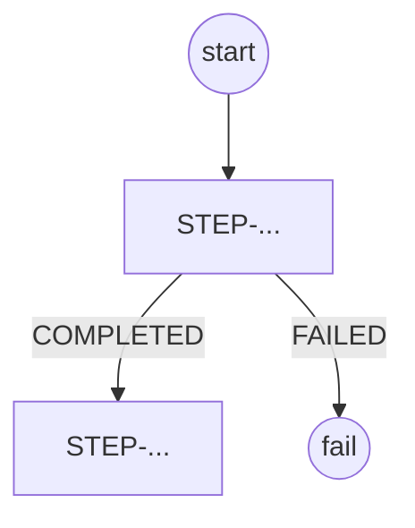

# JOB-<jobName>

| Field | Value | Evidence |
| --- | --- | --- |
| Defined in | | `path:line` |
| Trigger | scheduler / REST / CLI / `spring.batch.job.name` | |
| Parameters | name (identifying?), type, default | |
| Incrementer | `RunIdIncrementer` / none | |
| Restartable | yes/no, `startLimit`, `allowStartIfComplete` | |
| Listeners | class -> what it does | |

## Step graph

## Steps

### STEP-<jobName>.<stepName>

| Field | Value | Evidence |
| --- | --- | --- |
| Type | chunk / tasklet / partitioned / flow | |
| Chunk size | | |
| Reader | class, source, query or file layout, sort, page size | |
| Processor | class(es) | |
| Writer | class, target, SQL or format, write mode | |
| Fault tolerance | skip/retry/no-rollback classes and limits | |
| Concurrency | task executor, threads, partition grid size | |
| Scope beans | `@StepScope` values bound from parameters/context | |

**Input layout** (file or query result)

| # | Field | Type | Width/pos | Nullable | Notes |
| --- | --- | --- | --- | --- | --- |

**Rules**

| ID | Condition | Effect | Evidence |
| --- | --- | --- | --- |
| RULE-001 | `status == 'X'` | item filtered (processor returns null) | `path:line` |

**Output layout**

| # | Field | Source | Format (date/number/padding) | Notes |
| --- | --- | --- | --- | --- |

Header/footer/trailer:

## Side effects

Emails, events, audit rows, file moves, external calls.

## Configuration used

| Key | Default | Used at |
| --- | --- | --- |

## Tests covering this job

## NOTES for replication

- NOTE: (bug / non-determinism / hard-coded value) `path:line`
